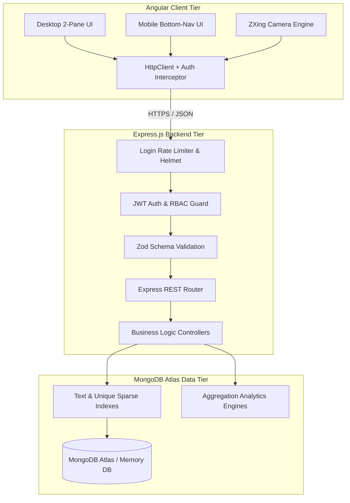
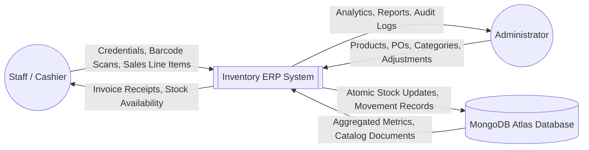

# MCA Mini Project Report: Inventory Management System with Phone-Camera Barcode Scanner Integration

---

## 1. Project Abstract
The **Inventory Management System with Phone-Camera Barcode Scanner Integration** is an enterprise-grade web application developed as a Master of Computer Applications (MCA) mini project. The application addresses the operational challenges of retail and warehouse inventory management—specifically the prohibitive cost of dedicated industrial barcode hardware and the lack of responsive, real-time stock reconciliation.

By leveraging modern web standards, the system turns any standard Android smartphone camera into an instant industrial-grade barcode scanner using the ZXing multi-format reader engine. Built with an Angular standalone client and an Express/Node.js/MongoDB Atlas cloud database backend, the system enforces atomic stock transactions, prevents inventory overselling, generates print-ready GST invoices, provides deep analytics via MongoDB aggregation pipelines, and delivers purpose-designed distinct user experiences for mobile (360x800px) and desktop (1366px+) viewports.

---

## 2. Problem Statement
Small-to-medium enterprises (SMEs), university departments, and retail businesses face significant inventory inefficiencies:
1. **Hardware Cost Barrier:** Dedicated handheld laser barcode scanners ($100–$400 each) require USB connections or proprietary RF dongles, limiting mobility.
2. **Stock Discrepancies and Overselling:** Traditional systems lack atomic decrement and rollback controls, leading to concurrent checkout overselling and phantom stock.
3. **Poor Mobile Usability:** Most existing ERP/inventory systems are desktop-only web interfaces that shrink unreadably on mobile devices rather than providing dedicated touch ergonomics.
4. **Lack of Immutable Audit Trails:** Unauthorized manual quantity adjustments often go untracked, making inventory theft and auditing failures common.

---

## 3. Objectives and Scope

### 3.1 Primary Objectives
- **Zero-Hardware Barcode Scanning:** Enable real-time EAN-13, EAN-8, and Code-128 barcode recognition via standard Android mobile browser cameras with zero app store installation.
- **Atomic Stock Management:** Implement concurrent stock reservation and rollback mechanisms ensuring stock can never drop below zero.
- **Dual-Viewport Architecture:** Guarantee distinct responsive ergonomics—two-pane POS for desktop; sticky bottom cart and drawer navigation for mobile.
- **Live Auditing & Reporting:** Track every unit addition and reduction with immutable stock movement audit records, accompanied by real-time aggregation dashboards and CSV exports.

### 3.2 Scope
- **User Roles:** System Administrator (Full configuration, user creation, price adjustments, stock reconciliation) and Staff (Barcode lookup, sales billing POS, purchase receipt).
- **Supported Barcode Symbologies:** EAN-13, EAN-8, UPC-A, UPC-E, and Code-128.
- **Deployment Target:** MongoDB Atlas cloud cluster with automated local embedded MongoDB fallback for zero-configuration viva evaluations.

---

## 4. System Requirements

### 4.1 Functional Requirements
- **FR1: Role-Based Authentication:** JWT-based secure login, session verification, active/disabled account enforcement, and bcrypt password hashing.
- **FR2: Product & Category Catalog:** Server-side paginated product catalog with sparse unique barcode indexing, text search, and low-stock reorder indicators.
- **FR3: Procurement & Receiving:** Two-pane Purchase Order workflow ensuring draft POs do not affect stock, while single-click receiving atomically increments stock.
- **FR4: POS Billing & Sales:** Live barcode scanning into cart, automated tax and discount calculation, atomic stock validation at commit, and print-ready tax invoice generation.
- **FR5: Phone Camera Barcode Engine:** WebRTC live video feed, environmental rear-camera selection, targeting reticle, audio beep synthesis, and device vibration feedback.
- **FR6: Stock Movement Ledger:** Append-only history logging previous quantity, new quantity, reference transaction, user ID, and reason.
- **FR7: Analytics & Reporting:** Real-time metrics for inventory valuation, sales trends, and CSV data export.

### 4.2 Non-Functional Requirements
- **Performance:** Initial client bundle under 100 kB gzipped; barcode lookup under 200 ms; route changes under 100 ms via lazy-loaded standalone chunks.
- **Security:** Helmet HTTP headers, CORS origin whitelisting, login brute-force rate limiting (15 attempts/15 min), and Zod input validation schemas.
- **Usability:** Minimum 44x44px touch targets on mobile; inputs set to 16px to prevent viewport zoom on Android/iOS; viewport-fit=cover and dynamic viewport units (`100dvh`).

---

## 5. System Architecture & Diagrams

### 5.1 Three-Tier System Architecture


### 5.2 Use Case Diagram
```mermaid
graph LR
    actor Staff as "Staff User"
    actor Admin as "System Administrator"

    Staff --> UC_Login[Login & Authenticate]
    Staff --> UC_Scan[Scan Barcode with Camera]
    Staff --> UC_Search[Search Catalog Items]
    Staff --> UC_Sale[Process Sales & POS]
    Staff --> UC_Print[Print Customer Invoice]
    Staff --> UC_Receive[Receive Purchase Goods]

    Admin --> UC_Login
    Admin --> UC_Scan
    Admin --> UC_Users[Manage User Accounts]
    Admin --> UC_Products[Create / Edit / Archive Products]
    Admin --> UC_PO[Create Purchase Orders]
    Admin --> UC_Adjust[Authorized Stock Adjustment]
    Admin --> UC_Reports[View Analytics & Export CSV]
```

### 5.3 Level 0 Context Data Flow Diagram (DFD)


### 5.4 Database Entity-Relationship (ER) Diagram
```mermaid
erDiagram
    USER ||--o{ SALE : processes
    USER ||--o{ PURCHASE : receives
    USER ||--o{ STOCK_MOVEMENT : authorizes
    CATEGORY ||--o{ PRODUCT : categorizes
    SUPPLIER ||--o{ PURCHASE : fulfills
    PRODUCT ||--o{ SALE_ITEM : included_in
    PRODUCT ||--o{ PURCHASE_ITEM : ordered_in
    PRODUCT ||--o{ STOCK_MOVEMENT : tracks

    USER {
        ObjectId _id PK
        string name
        string email UK
        string password
        string role "admin | staff"
        string status "active | disabled"
        date lastLogin
    }

    CATEGORY {
        ObjectId _id PK
        string name UK
        string description
        boolean active
    }

    PRODUCT {
        ObjectId _id PK
        string name
        string sku UK
        string barcode UK_Sparse
        ObjectId category FK
        number purchasePrice
        number sellingPrice
        number currentStock
        number minStock
        string uom
        string status "active | archived"
    }

    SUPPLIER {
        ObjectId _id PK
        string name
        string contactPerson
        string phone
        string email
        string address
        boolean active
    }

    PURCHASE {
        ObjectId _id PK
        string purchaseNumber UK
        ObjectId supplier FK
        date purchaseDate
        date receivedDate
        number subtotal
        number total
        string status "draft | received | cancelled"
    }

    SALE {
        ObjectId _id PK
        string invoiceNumber UK
        date saleDate
        string customerName
        string customerPhone
        number subtotal
        number discount
        number tax
        number grandTotal
        string paymentMethod
        ObjectId processedBy FK
        string status "completed | cancelled"
    }

    STOCK_MOVEMENT {
        ObjectId _id PK
        ObjectId product FK
        string movementType "purchase | sale | adjustment"
        number quantityChange
        number previousQuantity
        number newQuantity
        ObjectId user FK
        string reason
        date createdAt
    }
```

---

## 6. Limitations & Future Scope

### Limitations
- Phone-camera barcode recognition requires adequate lighting and camera autofocus capability.
- Offline-first progressive synchronization is not included in this phase (requires live backend API connectivity).

### Future Scope
- Progressive Web App (PWA) offline service-worker caching with background IndexedDB synchronization.
- Automated low-stock procurement email alerts sent directly to registered suppliers via SMTP/SendGrid.
- Support for 2D QR codes and RFID reader device integration.
